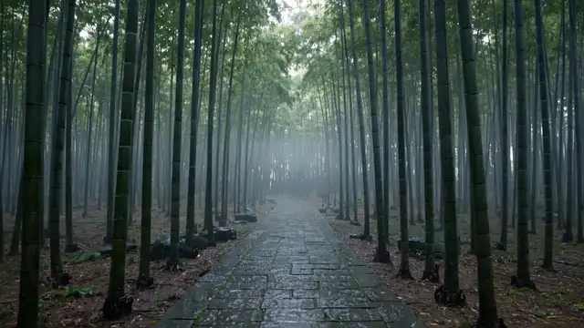
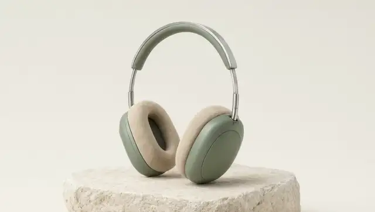
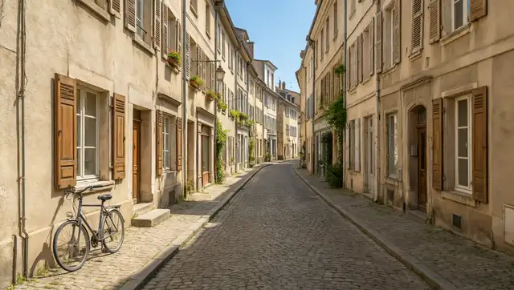
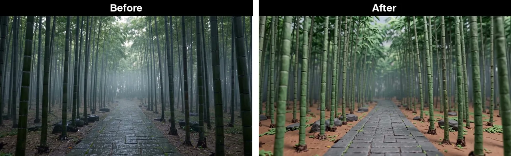
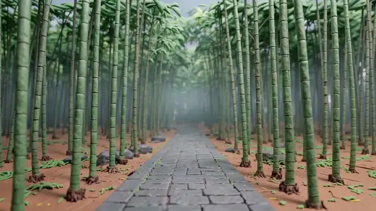

# Awesome Wan 3.0 Video

[English](./README.md) | [简体中文](./README.zh-CN.md) | 日本語

> 👉 こちらもどうぞ [Awesome Qwen Image 3.0](https://github.com/beatra-ai/awesome-qwen-image-3)

Wan 3.0 Video の実例です。各カードに完全なプロンプトがあり、エージェントで再現できます。

以下の事例はすべてこのモデルで Beatra 上で実際に生成したもので、プロンプトはそのまま掲載し、各カードにタスク ID を記載しています。

エージェントでそのまま再現: `npx skills add beatra-ai/ai-video-generator-skill` · [beatra.ai](https://beatra.ai/?utm_source=github&utm_medium=cases_list&utm_campaign=awesome-wan-3-video)

## 目次

- [テキストからの映画のような映像](#cinematic-t2v)
- [商品写真からの動画](#product-i2v)
- [最初と最後のフレーム](#first-last-frames)
- [動画の編集と描き直し](#video-edit)
- [動画の延長](#video-extend)
- [参照画像からの動画](#reference-to-video)
- [環境音](#native-audio)

<a id="cinematic-t2v"></a>

## テキストからの映画のような映像

### 1. スチール時計に寄る

スチールの腕時計への寄りで、Wan 3.0 Video が映画のような商品ショットを保っています。

<p align="center"></p>

[▶ フル動画を見る（MP4）](assets/w01.mp4)

*濡れた黒い石の上のスチール時計です。カメラが近づいています。Beatra AI で生成しています。*

エージェントへの依頼例：

```text
Wan 3.0 Video で、架空のスチール時計へゆっくり寄って。文字盤は深夜の青、濡れた黒い石の上。ロゴはなし。
```

プロンプト：

```text
Cinematic luxury product ad shot. A steel automatic wristwatch with a deep midnight-blue sunburst dial, plain polished baton hour markers, no text and no logos on the dial, lies on a slab of wet black stone covered in small water droplets. Dark studio, soft rim light traces the case edge and bracelet, a gentle highlight glides across the sapphire crystal. The camera makes one slow, steady push-in from a three-quarter view toward the dial; a single water droplet slides slowly down the stone beside the watch. The watch stays perfectly still and keeps its exact shape, the second hand ticks smoothly. Shallow depth of field, crisp macro detail, restrained elegant pacing, ends on a close framing of the dial. Subtle ambient sound of soft water drips.
```

Wan 3.0 Video · テキストから動画 · 720p · 16:9 · 4s

Beatra で生成 · タスク task_mcp_0d4597418c89a475d8b6526e91d440f90e5cea5e

### 2. 黄昏の木桟橋とフェリー

黄昏の木桟橋のフェリーで、Wan 3.0 Video が静かな水面の上を、映画のようなカメラワークで動いています。

<p align="center"></p>

[▶ フル動画を見る（MP4）](assets/w02.mp4)

*黄昏、暗い青緑のフェリーが木の桟橋に寄り、カメラが横に動いています。Beatra AI で生成しています。*

エージェントへの依頼例：

```text
Wan 3.0 Video で黄昏のショットを。架空の暗い青緑のフェリーが木の桟橋に寄り、暖かい灯が一つ。カメラはゆっくり横へ。ロゴはなし。
```

プロンプト：

```text
Cinematic dusk on a fictional coastal pier. A dark teal ferry rests against weathered timber, pale water, a wheat-colored sky, and one warm lamp on a post. Slow lateral camera move, gentle ripples. No people near the camera, no readable text, no logos, no watermark.
```

Wan 3.0 Video · テキストから動画 · 720p · 16:9 · 4s

Beatra で生成 · タスク task_mcp_dbace868ff0952ccc9a70df10b209a5438f5de89

### 3. 霧の竹林を前へ進むドリー

霧の竹林の道を前へ進むドリーで、Wan 3.0 Video がカメラを前に動かしています。

<p align="center"></p>

[▶ フル動画を見る（MP4）](assets/w15.mp4)

*濡れた石の道が、高い竹と薄い霧の中を通っています。カメラは前へ動いています。Beatra AI で生成しています。*

エージェントへの依頼例：

```text
Wan 3.0 Video で、夜明けの霧の竹林を。濡れた石の道を、カメラがゆっくり前へ。人も文字もなし。
```

プロンプト：

```text
Cinematic morning in a fictional bamboo grove. Dense tall bamboo, pale mist drifting between the stalks, a wet stone path, slow steady dolly forward along the path. Soft dawn light, no people, no readable text, no logos, no watermark. Subtle ambient sound of dripping water and distant birds.
```

Wan 3.0 Video · テキストから動画 · 720p · 16:9 · 5s

Beatra で生成 · タスク task_mcp_0b83031c5911be94eed4408160a82d4636fde04a

### 4. ローアングルで見る夜店の鉄鍋

夜店の鉄鍋を低い角度から見た、Wan 3.0 Video の映像です。湯気と炎があります。

<p align="center"></p>

[▶ フル動画を見る（MP4）](assets/w16.mp4)

*低い角度の鉄鍋がガスの炎の上にあり、湯気が上がっています。提灯の光があります。Beatra AI で生成しています。*

エージェントへの依頼例：

```text
Wan 3.0 Video で、夜店の鉄鍋を手持ちの低い角度で。ガスの炎の上、湯気が上がる、提灯の光。
```

プロンプト：

```text
Handheld low-angle shot at a fictional night stall. A wide iron wok sits over a gas flame, thick steam and oil mist rising toward the camera, warm lantern light, wooden stall counter. No people, no faces, no hands, no readable signs, no letters, no logos, no watermark. Soundtrack of sizzle and soft night-market murmur, no speech.
```

Wan 3.0 Video · テキストから動画 · 720p · 16:9 · 5s

Beatra で生成 · タスク task_mcp_f7de08036b16d5059c82dc3bcebfcbd51fdcbb0c

<a id="product-i2v"></a>

## 商品写真からの動画

### 5. Siltjar の瓶に寄る

瓶へのゆっくりした寄りで、Wan 3.0 Video が一枚の開始写真から SILTJAR の瓶を動かしています。

<p align="center"></p>

[▶ フル動画を見る（MP4）](assets/w03.mp4)

*カメラが、テラコッタ色の瓶と乾燥唐辛子へゆっくり近づきます。開始写真も Beatra AI で生成しています。*

エージェントへの依頼例：

```text
Wan 3.0 Video でこの Siltjar の瓶の写真を、ゆっくり寄る動きにして。瓶、キャップ、唐辛子、SILTJAR のラベルは止めたまま。
```

プロンプト：

```text
Slow push-in on the hot-sauce bottle. The bottle, black cap, and dried chilies stay still. The cream label keeps the exact word SILTJAR. Soft window light. No new text, no hands, no logos.
```

Wan 3.0 Video · 画像から動画 · 720p · 1:1 · 4s

Beatra で生成 · タスク task_mcp_ef9245dcc190be76719d6d88778ad26b9105f91a

### 6. 真鍮キャンドルの周回

真鍮のキャンドル缶を回るカメラで、Wan 3.0 Video が一枚の商品写真を動かしています。

<p align="center"></p>

[▶ フル動画を見る（MP4）](assets/w04.mp4)

*カメラが、オークの卓の真鍮キャンドルとローズマリーの周りを回ります。開始写真も Beatra AI で生成しています。*

エージェントへの依頼例：

```text
Wan 3.0 Video でこの真鍮キャンドルの写真を、ゆっくり周回する動きにして。缶はオークの卓に、ローズマリーはその場所に。
```

プロンプト：

```text
The brass candle tin stays on the oak table with its wick unlit. A slow gentle orbit, the rosemary sprig stays put, and the warm side light shifts slightly. No text, no people, no hands, no logos.
```

Wan 3.0 Video · 画像から動画 · 720p · 4:3 · 4s

Beatra で生成 · タスク task_mcp_988a9e1161b17e8d923dfe7bdf547e0d26ea97e3

### 7. SOLUM の瓶に寄る

瓶へのゆっくりした寄りで、Wan 3.0 Video が一枚の開始写真から SOLUM の瓶を動かしています。

<p align="center"></p>

[▶ フル動画を見る（MP4）](assets/w17.mp4)

*カメラが SOLUM の瓶へゆっくり近づき、周りの水面に波紋があります。開始写真も Beatra AI で生成しています。*

エージェントへの依頼例：

```text
Wan 3.0 Video でこの SOLUM の瓶の写真を、ゆっくり寄る動きにして。瓶、白いポンプ、SOLUM のラベルは止めたまま。周りの水面に波紋を。
```

プロンプト：

```text
Slow push-in on the frosted-glass serum bottle. The bottle, white pump, and SOLUM label stay still and keep their shape. Gentle ripples move in the water around the base. Soft beauty light. No new text, no hands, no logos.
```

Wan 3.0 Video · 画像から動画 · 720p · 16:9 · 5s

Beatra で生成 · タスク task_mcp_747899488daf1c608e01a3103a86f767cebd0a01, task_mcp_894f444a5ed34962098546e9a34cfc0b801d9b76

### 8. セージグリーンのヘッドホンの周回

ゆっくり回るカメラで、Wan 3.0 Video が一枚の開始写真からセージグリーンのヘッドホンを動かしています。

<p align="center"></p>

[▶ フル動画を見る（MP4）](assets/w18.mp4)

*カメラが石灰岩の上のセージグリーンのヘッドホンの周りを回ります。開始写真も Beatra AI で生成しています。*

エージェントへの依頼例：

```text
Wan 3.0 Video でこのセージグリーンのヘッドホンの写真を、ゆっくり回る動きにして。カップ、ヘッドバンド、スエードのパッドの形はそのまま。
```

プロンプト：

```text
Slow gentle orbit around the sage over-ear headphones on the limestone slab. The cups, headband, and suede pads keep their shape. Soft studio light. No text, no people, no hands, no logos.
```

Wan 3.0 Video · 画像から動画 · 720p · 16:9 · 5s

Beatra で生成 · タスク task_mcp_30b180b44416554aedc800ae7ea54ded5091b344, task_mcp_769d854eae895afbf4a0127ff02c2c5984a1df29

<a id="first-last-frames"></a>

## 最初と最後のフレーム

### 9. トートが室内から雨の入口へ

同じトートが明るい部屋から雨の入口へ移り、Wan 3.0 Video が二つのフレームをつないでいます。

<p align="center"></p>

*左は冒頭のフレームで、明るい部屋のトートと洋梨です。右は完成した映像の、雨の入口です。前後のフレームも Beatra AI で生成しています。*

<p align="center"></p>

[▶ フル動画を見る（MP4）](assets/w05.mp4)

*左は冒頭のフレームで、明るい部屋のトートと洋梨です。右は完成した映像の、雨の入口です。前後のフレームも Beatra AI で生成しています。*

エージェントへの依頼例：

```text
Wan 3.0 Video で、最初のフレームは明るい部屋のトート、最後のフレームは雨の入口のトート。袋、持ち手、洋梨は揃えて。
```

プロンプト：

```text
The oat linen tote and the green pear move from the bright indoor floor to the rainy shop doorway. The bag's pocket, two handles, and the pear stay consistent. No text, no people, no logos.
```

Wan 3.0 Video · 最初と最後のフレームから動画 · 720p · 3:4 · 4s

Beatra で生成 · タスク task_mcp_0a09065cc402d1095c39f1dd2e55c27c9d2c992b

### 10. 狐がベーカリーまで歩く

黄色いコートの狐がキノコからベーカリーまで歩き、Wan 3.0 Video が二つのフレームをつないでいます。

<p align="center"></p>

*左は冒頭のフレームで、キノコの下にいる黄色いコートの狐です。右は完成した映像の、ベーカリーの前の狐です。前後のフレームも Beatra AI で生成しています。*

<p align="center"></p>

[▶ フル動画を見る（MP4）](assets/w06.mp4)

*左は冒頭のフレームで、キノコの下にいる黄色いコートの狐です。右は完成した映像の、ベーカリーの前の狐です。前後のフレームも Beatra AI で生成しています。*

エージェントへの依頼例：

```text
Wan 3.0 Video で、最初のフレームはレインコートの狐、最後はベーカリー。狐を歩道まで歩かせ、コート、長靴、ひさしは揃えて。
```

プロンプト：

```text
The red fox in the yellow raincoat and green boots walks from the plain background to the sidewalk in front of the bakery. The coat, boots, and face stay consistent, and the bakery awning and bicycle remain. No text, no logos.
```

Wan 3.0 Video · 最初と最後のフレームから動画 · 720p · 1:1 · 4s

Beatra で生成 · タスク task_mcp_fff02ba9a872ad57f1ce5244c80e73fa59f4aa0a

### 11. 路地が夏の昼から夕方へ

同じ路地が夏の昼から夕方へ移り、Wan 3.0 Video が二つのフレームをつないでいます。映像の終わりの雪は、最後のフレームにした夕方の写真より少ないです。

<p align="center"></p>

[▶ フル動画を見る（MP4）](assets/w19.mp4)

*路地が明るい夏の昼から夕方になり、窓と街灯が灯っています。映像の終わりの雪は、最後のフレームにした夕方の写真より少ないです。最初と最後のフレームも Beatra AI で生成しています。*

エージェントへの依頼例：

```text
Wan 3.0 Video で、最初のフレームは夏の昼の路地、最後のフレームは夕方の路地。建物、鎧戸、扉、自転車は元の位置のまま。
```

プロンプト：

```text
The cobblestone lane changes from bright summer noon to a snowy evening. Buildings, shutters, doors, and the bicycle stay in place. Light snow begins to fall. No people, no cars, no readable text, no logos.
```

Wan 3.0 Video · 最初と最後のフレームから動画 · 720p · 16:9 · 5s

Beatra で生成 · タスク task_mcp_7b7da46f37b24ab2619dc76ac34abddffdd2abc7, task_mcp_a36f684023317a21916a2df525593b22e69b611c, task_mcp_dffd403279fad7006f39d5e1889472473ef09da6

<a id="video-edit"></a>

## 動画の編集と描き直し

### 12. 卓が緑のタイルに

オークの卓が緑のタイルになり、キャンドルは残り、Wan 3.0 Video が映像を編集しています。

<p align="center"></p>

*左は元の映像の一フレームで、オークの卓の上です。右は編集後の映像で、暗い緑のタイルの上です。編集前の映像も Beatra AI で生成しています。*

<p align="center"></p>

[▶ フル動画を見る（MP4）](assets/w07.mp4)

*左は元の映像の一フレームで、オークの卓の上です。右は編集後の映像で、暗い緑のタイルの上です。編集前の映像も Beatra AI で生成しています。*

エージェントへの依頼例：

```text
Wan 3.0 Video でこのキャンドルの映像を編集して。暗いオークの卓を暗い緑のタイルに。真鍮の缶、芯、ローズマリーはそのまま。カメラは固定。
```

プロンプト：

```text
Replace the dark oak table with dark green glazed tile. Keep the brass candle tin, the unlit wick, the rosemary sprig, and the still camera. No text, no logos, no people, no hands.
```

Wan 3.0 Video · 動画編集 · 720p · 16:9 · 5s

Beatra で生成 · タスク task_mcp_74e663e18496ceda5d0af892f727d96a169765f5

### 13. 同じキャンドルをガッシュに

同じキャンドルの映像がガッシュに描き直され、Wan 3.0 Video が動画のスタイルを変えています。

<p align="center"></p>

*左は元の映像の一フレームで、オークの卓の上の真鍮キャンドルです。右は編集後の映像で、同じキャンドルがガッシュで描き直されています。編集前の映像も Beatra AI で生成しています。*

<p align="center"></p>

[▶ フル動画を見る（MP4）](assets/w08.mp4)

*左は元の映像の一フレームで、オークの卓の上の真鍮キャンドルです。右は編集後の映像で、同じキャンドルがガッシュで描き直されています。編集前の映像も Beatra AI で生成しています。*

エージェントへの依頼例：

```text
Wan 3.0 Video でこのキャンドルの映像を、紙の質感のあるガッシュに描き直して。真鍮の缶、芯、ローズマリー、構図はそのまま。
```

プロンプト：

```text
Repaint this shot as a gouache illustration with visible paper texture and soft indigo shadows. Keep the brass tin, the unlit wick, the rosemary, and the still framing. No text, no logos, no people.
```

Wan 3.0 Video · 動画編集 · 720p · 16:9 · 5s

Beatra で生成 · タスク task_mcp_f128b0fbaaeeb9efa301aa9a8fa3992f03b13409

### 14. 竹の道を粘土のコマ撮りに

竹の道が粘土のコマ撮りの質感に描き直され、Wan 3.0 Video がこの映像のスタイルを変えています。

<p align="center"></p>

*左は元の映像の一フレームで、竹林と濡れた石の道です。右は完成した映像の一フレームで、同じショットが粘土のコマ撮りの質感に描き直されています。編集前の映像も Beatra AI で生成しています。*

<p align="center"></p>

[▶ フル動画を見る（MP4）](assets/w20.mp4)

*左は元の映像の一フレームで、竹林と濡れた石の道です。右は完成した映像の一フレームで、同じショットが粘土のコマ撮りの質感に描き直されています。編集前の映像も Beatra AI で生成しています。*

エージェントへの依頼例：

```text
Wan 3.0 Video でこの竹林の映像を、粘土のコマ撮りの質感に描き直して。竹林、濡れた石の道、ゆっくり前へ進むカメラはそのまま。
```

プロンプト：

```text
Repaint this shot as clay stop-motion. Keep the bamboo grove, the wet stone path, and the slow forward camera. Visible clay texture and fingerprints on the stalks and stones. No people, no readable text, no logos.
```

Wan 3.0 Video · 動画編集 · 720p · 16:9 · 5s

Beatra で生成 · タスク task_mcp_0b83031c5911be94eed4408160a82d4636fde04a, task_mcp_d09dd996bc8a0a80f4d53a4bbc626a2ad51411d1

<a id="video-extend"></a>

## 動画の延長

### 15. 映像のあとで芯に火

火のついていないキャンドルが灯った芯へ続き、Wan 3.0 Video が映像のあとに画面を足しています。

<p align="center"></p>

[▶ フル動画を見る（MP4）](assets/w09.mp4)

*キャンドルの映像が続き、芯に小さな火が付きます。延長前の映像も Beatra AI で生成しています。*

エージェントへの依頼例：

```text
Wan 3.0 Video で、火のついていないキャンドルの映像の続きを作って。その後、芯に小さな安定した火が入り、ローズマリーは止めたまま。
```

プロンプト：

```text
Continue after the clip. The wick catches a small steady flame and the wax glow warms the brass tin. The rosemary stays still. No text, no people, no hands.
```

Wan 3.0 Video · 動画の延長 · 720p · 16:9 · 5s

Beatra で生成 · タスク task_mcp_a869a7eb9616f0bb898e78c09d749e71e6cd80de

### 16. キャンドルからカメラが引く

同じキャンドルからカメラが引き、Wan 3.0 Video が同じ映像をもう一度延長しています。

<p align="center"></p>

[▶ フル動画を見る（MP4）](assets/w10.mp4)

*カメラが引き、キャンドルの周りのオークの卓がもっと見えます。延長前の映像も Beatra AI で生成しています。*

エージェントへの依頼例：

```text
Wan 3.0 Video でこのキャンドルの映像の続きを、ゆっくり引くカメラで。オークの卓がもっと見えるように。キャンドルに火は付けないで。
```

プロンプト：

```text
Continue after the clip. The camera slowly pulls back until more of the oak table is visible around the brass tin and the rosemary. The candle stays unlit. No text, no people, no hands.
```

Wan 3.0 Video · 動画の延長 · 720p · 16:9 · 5s

Beatra で生成 · タスク task_mcp_6175a68010f69abddaa776f1d343fb135a1d8d91

<a id="reference-to-video"></a>

## 参照画像からの動画

### 17. スニーカーとトートの短い映像

カタログ風の移動で、Wan 3.0 Video がスニーカーとトートの参照写真から短い映像を作っています。

<p align="center"></p>

[▶ フル動画を見る（MP4）](assets/w11.mp4)

*キャンバスの靴とリネンのトートが淡い床の上にあり、カメラが近づきます。参照画像も Beatra AI で生成しています。*

エージェントへの依頼例：

```text
Wan 3.0 Video にオートミール色のスニーカーとリネントートの写真を渡して。白い壁の前の淡いテラゾーで、両方へゆっくり寄る短い映像に。
```

プロンプト：

```text
A short catalog clip of the oatmeal sneaker and the oat linen tote together on a pale terrazzo floor against a white wall. Morning light, slow push-in. Keep the gum sole and the tote's patch pocket. No text, no logos, no hands.
```

Wan 3.0 Video · 参照素材から動画 · 720p · 16:9 · 3s

Beatra で生成 · タスク task_mcp_624760781be03b029dcdc2fcf9bc52cdd0f9959e

### 18. ベーカリーの前のレインコートの狐

レインコートの狐がベーカリーの前に立ち、Wan 3.0 Video が二枚の挿絵の参照に沿っています。

<p align="center"></p>

[▶ フル動画を見る（MP4）](assets/w12.mp4)

*黄色いコートの狐が、ベーカリーの前の歩道に立っています。参照画像も Beatra AI で生成しています。*

エージェントへの依頼例：

```text
Wan 3.0 Video にレインコートの狐の絵とベーカリーの絵を渡して。黄色いひさしの下の歩道に狐を立たせ、ひさしが少し風で動くように。
```

プロンプト：

```text
A short illustrated clip. The red fox in the yellow raincoat and green boots stands on the sidewalk in front of the bakery with the butter-yellow awning and the bicycle. A small breeze moves the awning. No text, no logos.
```

Wan 3.0 Video · 参照素材から動画 · 720p · 16:9 · 3s

Beatra で生成 · タスク task_mcp_ca240b90f5508336024a11c8fd8226cdd4581f22

<a id="native-audio"></a>

## 環境音

### 19. 小屋の雪と煙

雪と煙突の煙がある、Wan 3.0 Video の小屋のショットです。完成した映像には音が入っています。

<p align="center"></p>

[▶ フル動画を見る（MP4）](assets/w13.mp4)

*小屋に雪が降り、煙突の煙が上がり、カメラが近づきます。開始写真も Beatra AI で生成しています。*

エージェントへの依頼例：

```text
Wan 3.0 Video でこの雪の小屋の静止画を動かして。降る雪、左へ巻く煙突の煙、ゆっくり寄るカメラ。音は風と雪。
```

プロンプト：

```text
Gentle falling snow drifts down across the whole scene in soft, slow flakes. Chimney smoke rises and curls lazily to the left. The window light glows warmly with a faint flicker. The camera makes one slow, smooth push-in toward the cabin. The cabin, roof, pine trees and mountains stay still and keep their exact shape. Calm, quiet winter evening pacing. Soft ambient sound of wind and falling snow.
```

Wan 3.0 Video · 画像から動画 · 720p · 16:9 · 5s

Beatra で生成 · タスク task_mcp_38a287641ce61bf1d0ab5fe2892aab3f86ba3643, task_mcp_4164f98cbccff4bdb8588c227998756a9f3d8423

### 20. ベーカリーの段に降る雨

ベーカリーの段に降る雨の、Wan 3.0 Video の映像です。完成した映像には音が入っています。

<p align="center"></p>

[▶ フル動画を見る（MP4）](assets/w14.mp4)

*黄色いひさしの下の濡れた段に雨が当たり、音は雨と店の鈴です。Beatra AI で生成しています。*

エージェントへの依頼例：

```text
Wan 3.0 Video で架空のベーカリーの外、雨の夜を。バター色のひさしの下、濡れた石段に雨。音は雨と、店の鈴が一度。話し声もロゴもなし。
```

プロンプト：

```text
Rainy evening outside a small fictional bakery. Rain strikes a wet stone step under a dripping butter-yellow awning, with a dark green door behind. The soundtrack is rain and one soft distant shop bell. No speech, no music, no people, no readable text, no logos.
```

Wan 3.0 Video · テキストから動画 · 720p · 16:9 · 4s

Beatra で生成 · タスク task_mcp_d62a422f1980a916a57b1f20bb5e679e138795f6

## Beatra で動かす理由

- このリストで使ったモデル：Wan 3.0 Video。
- インストールは無料。生成のたびに Beatra アカウントのクレジットを消費しますが、課金されるのは、その生成を明示的に依頼したとき、または確認カードを承認したときだけです。
- 対応エージェント：Claude Code、Cursor、Codex、Windsurf、Cline、OpenClaw。

## コントリビュート

追加してほしい事例は issue でどうぞ。第三者の作品は受け付けていません。

## ライセンス

このリストのプロンプトと素材は CC BY 4.0 です。転載にはクレジットとリンクが必要です。

## 関連リンク

- [Awesome Qwen Image 3.0](https://github.com/beatra-ai/awesome-qwen-image-3)
- [AI Video Generator Skill](https://github.com/beatra-ai/ai-video-generator-skill)
- [Beatra Skills](https://github.com/beatra-ai/beatra-skills)
- [beatra.ai](https://beatra.ai/?utm_source=github&utm_medium=cases_list&utm_campaign=awesome-wan-3-video)
