# Awesome Wan 3.0 Video

[English](./README.md) | 简体中文 | [日本語](./README.ja.md)

> 👉 也看看 [Awesome Qwen Image 3.0](https://github.com/beatra-ai/awesome-qwen-image-3)

Wan 3.0 Video 的真实案例，每条都附完整提示词，可以在 Agent 里复现。

下面每条案例都在 Beatra 上用这个模型实际生成，提示词逐字照录，每张卡片都附任务号。

在你的 Agent 里直接复现: `npx skills add beatra-ai/ai-video-generator-skill` · [beatra.ai](https://beatra.ai/?utm_source=github&utm_medium=cases_list&utm_campaign=awesome-wan-3-video)

## 目录

- [电影感文生视频](#cinematic-t2v)
- [商品图生视频](#product-i2v)
- [首尾帧过渡](#first-last-frames)
- [视频编辑与重绘](#video-edit)
- [视频延长](#video-extend)
- [参考图生视频](#reference-to-video)
- [环境音](#native-audio)

<a id="cinematic-t2v"></a>

## 电影感文生视频

### 1. 推向一块钢表

镜头推向一块钢表，是 Wan 3.0 Video 做出的一段电影感商品镜头。

<p align="center">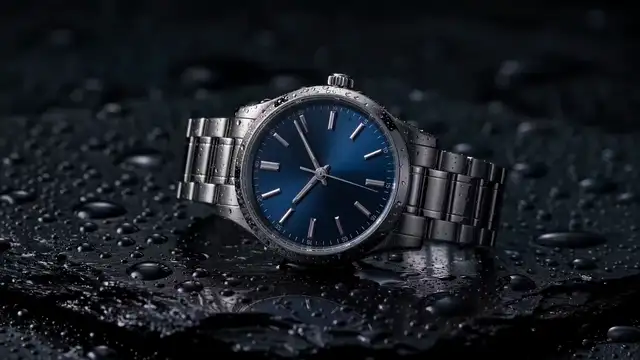</p>

[▶ 观看完整视频（MP4）](assets/w01.mp4)

*一块钢表放在湿的黑石上，镜头正在靠近。由 Beatra AI 生成。*

在你的 Agent 里这样说：

```text
用 Wan 3.0 Video 做一段缓慢推进：一块虚构的钢表，午夜蓝表盘，放在湿的黑石上。不要标志。
```

提示词：

```text
Cinematic luxury product ad shot. A steel automatic wristwatch with a deep midnight-blue sunburst dial, plain polished baton hour markers, no text and no logos on the dial, lies on a slab of wet black stone covered in small water droplets. Dark studio, soft rim light traces the case edge and bracelet, a gentle highlight glides across the sapphire crystal. The camera makes one slow, steady push-in from a three-quarter view toward the dial; a single water droplet slides slowly down the stone beside the watch. The watch stays perfectly still and keeps its exact shape, the second hand ticks smoothly. Shallow depth of field, crisp macro detail, restrained elegant pacing, ends on a close framing of the dial. Subtle ambient sound of soft water drips.
```

Wan 3.0 Video · 文生视频 · 720p · 16:9 · 4s

在 Beatra 上生成 · 任务 task_mcp_0d4597418c89a475d8b6526e91d440f90e5cea5e

### 2. 黄昏木栈桥边的渡轮

黄昏里木栈桥边的一艘渡轮，展示 Wan 3.0 Video 让电影感的镜头掠过平静的水面。

<p align="center"></p>

[▶ 观看完整视频（MP4）](assets/w02.mp4)

*黄昏里，一艘深青色渡轮靠着木栈桥，镜头在横向移动。由 Beatra AI 生成。*

在你的 Agent 里这样说：

```text
用 Wan 3.0 Video 做一段黄昏镜头：一艘虚构的深青色渡轮靠着木栈桥，一盏暖灯，镜头慢慢横移。不要标志。
```

提示词：

```text
Cinematic dusk on a fictional coastal pier. A dark teal ferry rests against weathered timber, pale water, a wheat-colored sky, and one warm lamp on a post. Slow lateral camera move, gentle ripples. No people near the camera, no readable text, no logos, no watermark.
```

Wan 3.0 Video · 文生视频 · 720p · 16:9 · 4s

在 Beatra 上生成 · 任务 task_mcp_dbace868ff0952ccc9a70df10b209a5438f5de89

<a id="product-i2v"></a>

## 商品图生视频

### 3. 推向 Siltjar 酱瓶

缓慢推向酱瓶，展示 Wan 3.0 Video 用一张开场照片把 SILTJAR 瓶子动起来。

<p align="center"></p>

[▶ 观看完整视频（MP4）](assets/w03.mp4)

*镜头慢慢朝陶红色瓶子和干辣椒推近。开头的照片也是由 Beatra AI 生成。*

在你的 Agent 里这样说：

```text
用 Wan 3.0 Video 把这张 Siltjar 酱瓶照片做成缓慢推进。瓶子、瓶盖、干辣椒和 SILTJAR 标签保持不动。
```

提示词：

```text
Slow push-in on the hot-sauce bottle. The bottle, black cap, and dried chilies stay still. The cream label keeps the exact word SILTJAR. Soft window light. No new text, no hands, no logos.
```

Wan 3.0 Video · 图生视频 · 720p · 1:1 · 4s

在 Beatra 上生成 · 任务 task_mcp_ef9245dcc190be76719d6d88778ad26b9105f91a

### 4. 绕着黄铜蜡烛转

镜头绕着黄铜蜡烛罐转，展示 Wan 3.0 Video 把一张商品照片动起来。

<p align="center">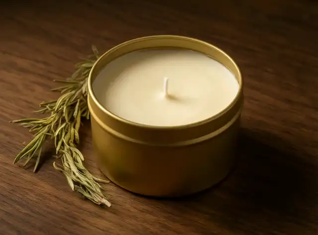</p>

[▶ 观看完整视频（MP4）](assets/w04.mp4)

*镜头绕着橡木桌上的黄铜蜡烛罐和一枝迷迭香转。开头的照片也是由 Beatra AI 生成。*

在你的 Agent 里这样说：

```text
用 Wan 3.0 Video 把这张黄铜蜡烛照片做成缓慢环绕。罐子留在橡木桌上，迷迭香留在原地。
```

提示词：

```text
The brass candle tin stays on the oak table with its wick unlit. A slow gentle orbit, the rosemary sprig stays put, and the warm side light shifts slightly. No text, no people, no hands, no logos.
```

Wan 3.0 Video · 图生视频 · 720p · 4:3 · 4s

在 Beatra 上生成 · 任务 task_mcp_988a9e1161b17e8d923dfe7bdf547e0d26ea97e3

<a id="first-last-frames"></a>

## 首尾帧过渡

### 5. 托特包从室内到雨门口

同一只托特包从明亮的房间移到下雨的门口，展示 Wan 3.0 Video 把两帧接起来。

<p align="center">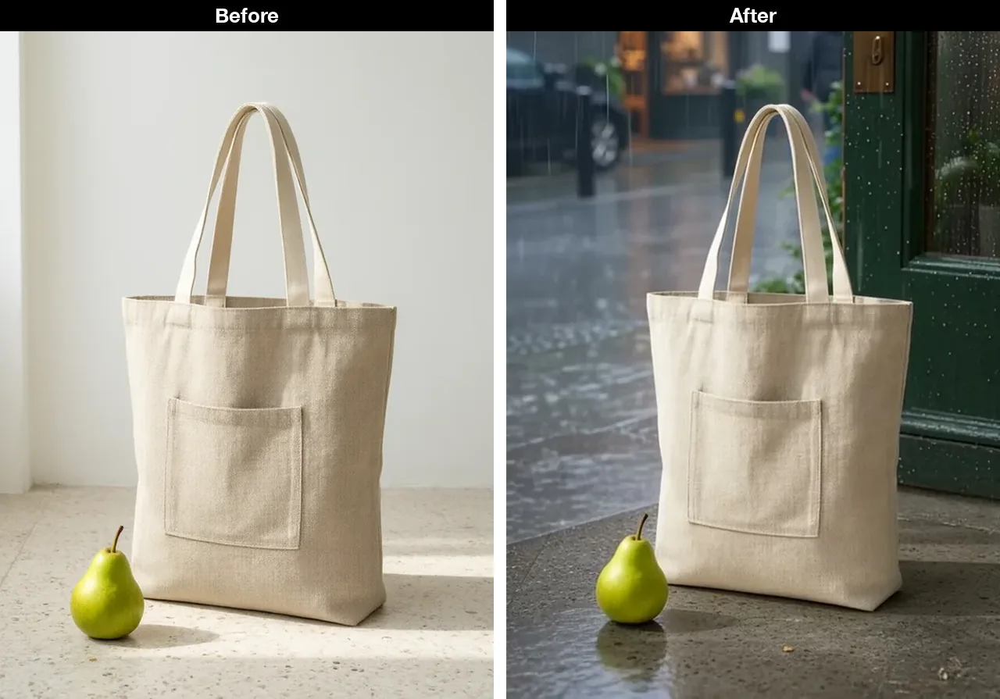</p>

*左是开头的一帧，明亮房间里的托特包和梨。右是成片里的下雨门口。前后两帧也都是由 Beatra AI 生成。*

<p align="center">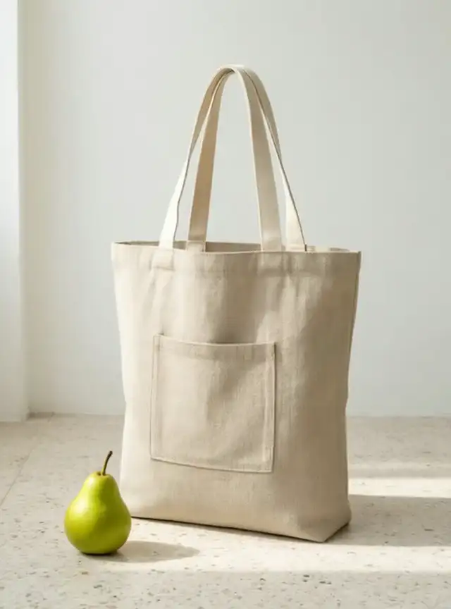</p>

[▶ 观看完整视频（MP4）](assets/w05.mp4)

*左是开头的一帧，明亮房间里的托特包和梨。右是成片里的下雨门口。前后两帧也都是由 Beatra AI 生成。*

在你的 Agent 里这样说：

```text
用 Wan 3.0 Video，第一帧用明亮房间里的托特包照片，最后一帧用雨门口的托特包照片。包、提手和梨保持一致。
```

提示词：

```text
The oat linen tote and the green pear move from the bright indoor floor to the rainy shop doorway. The bag's pocket, two handles, and the pear stay consistent. No text, no people, no logos.
```

Wan 3.0 Video · 首尾帧生视频 · 720p · 3:4 · 4s

在 Beatra 上生成 · 任务 task_mcp_0a09065cc402d1095c39f1dd2e55c27c9d2c992b

### 6. 狐狸走到面包店前

穿黄色外套的狐狸从蘑菇走到面包店，展示 Wan 3.0 Video 把两帧接起来。

<p align="center">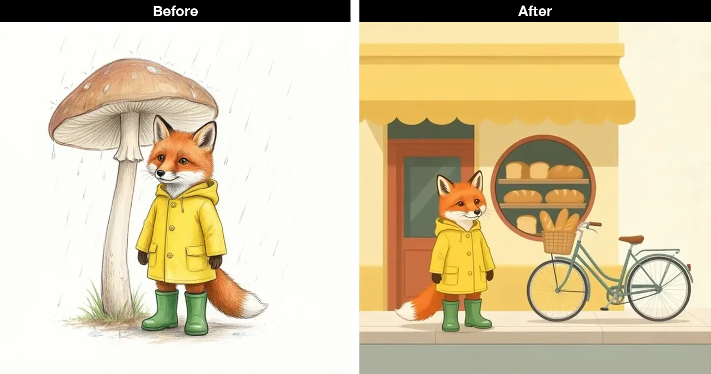</p>

*左是开头的一帧，穿黄色外套的狐狸在蘑菇下。右是成片里面包店外的狐狸。前后两帧也都是由 Beatra AI 生成。*

<p align="center">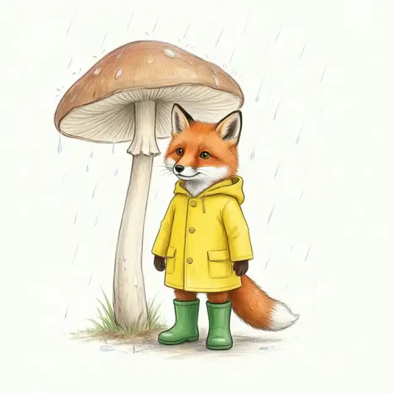</p>

[▶ 观看完整视频（MP4）](assets/w06.mp4)

*左是开头的一帧，穿黄色外套的狐狸在蘑菇下。右是成片里面包店外的狐狸。前后两帧也都是由 Beatra AI 生成。*

在你的 Agent 里这样说：

```text
用 Wan 3.0 Video，第一帧用雨衣狐狸的画，最后一帧用面包店的画。让狐狸走到人行道上，雨衣、靴子和遮阳篷保持一致。
```

提示词：

```text
The red fox in the yellow raincoat and green boots walks from the plain background to the sidewalk in front of the bakery. The coat, boots, and face stay consistent, and the bakery awning and bicycle remain. No text, no logos.
```

Wan 3.0 Video · 首尾帧生视频 · 720p · 1:1 · 4s

在 Beatra 上生成 · 任务 task_mcp_fff02ba9a872ad57f1ce5244c80e73fa59f4aa0a

<a id="video-edit"></a>

## 视频编辑与重绘

### 7. 桌面换成绿色瓷砖

橡木桌变成绿色瓷砖，蜡烛还在，展示 Wan 3.0 Video 编辑一段片子。

<p align="center">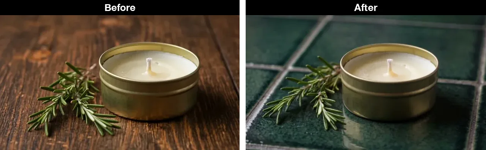</p>

*左是原片的一帧，在橡木桌上。右是编辑后的成片，在深绿色瓷砖上。被编辑的原片也是由 Beatra AI 生成。*

<p align="center">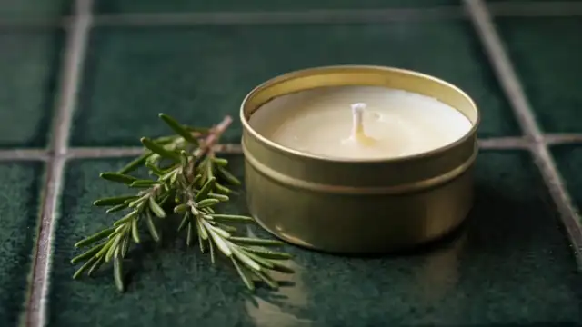</p>

[▶ 观看完整视频（MP4）](assets/w07.mp4)

*左是原片的一帧，在橡木桌上。右是编辑后的成片，在深绿色瓷砖上。被编辑的原片也是由 Beatra AI 生成。*

在你的 Agent 里这样说：

```text
用 Wan 3.0 Video 编辑这段蜡烛片子：把深色橡木桌换成深绿色瓷砖，黄铜罐、烛芯、迷迭香和静止的机位保持不变。
```

提示词：

```text
Replace the dark oak table with dark green glazed tile. Keep the brass candle tin, the unlit wick, the rosemary sprig, and the still camera. No text, no logos, no people, no hands.
```

Wan 3.0 Video · 视频编辑 · 720p · 16:9 · 5s

在 Beatra 上生成 · 任务 task_mcp_74e663e18496ceda5d0af892f727d96a169765f5

### 8. 同一段蜡烛改成水粉

同一段蜡烛被改画成水粉，展示 Wan 3.0 Video 给一段视频换风格。

<p align="center">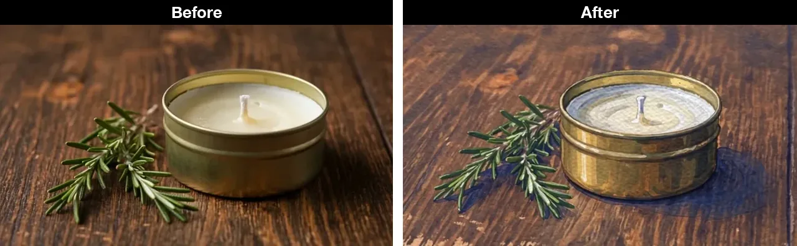</p>

*左是原片的一帧，黄铜蜡烛在橡木桌上。右是编辑后的成片，同一只蜡烛被画成水粉。被编辑的原片也是由 Beatra AI 生成。*

<p align="center"></p>

[▶ 观看完整视频（MP4）](assets/w08.mp4)

*左是原片的一帧，黄铜蜡烛在橡木桌上。右是编辑后的成片，同一只蜡烛被画成水粉。被编辑的原片也是由 Beatra AI 生成。*

在你的 Agent 里这样说：

```text
用 Wan 3.0 Video 把这段蜡烛片子改成有纸纹的水粉画。黄铜罐、烛芯、迷迭香和构图保持不变。
```

提示词：

```text
Repaint this shot as a gouache illustration with visible paper texture and soft indigo shadows. Keep the brass tin, the unlit wick, the rosemary, and the still framing. No text, no logos, no people.
```

Wan 3.0 Video · 视频编辑 · 720p · 16:9 · 5s

在 Beatra 上生成 · 任务 task_mcp_f128b0fbaaeeb9efa301aa9a8fa3992f03b13409

<a id="video-extend"></a>

## 视频延长

### 9. 片段之后烛芯点着

未点燃的蜡烛接到一根点着的烛芯，展示 Wan 3.0 Video 在片段之后补上画面。

<p align="center"></p>

[▶ 观看完整视频（MP4）](assets/w09.mp4)

*蜡烛的片子继续下去，烛芯点起一小团火。延长前的片子也是由 Beatra AI 生成。*

在你的 Agent 里这样说：

```text
用 Wan 3.0 Video 把这段未点燃的蜡烛片子往后接。接上之后烛芯点着一小团稳定的火，迷迭香保持不动。
```

提示词：

```text
Continue after the clip. The wick catches a small steady flame and the wax glow warms the brass tin. The rosemary stays still. No text, no people, no hands.
```

Wan 3.0 Video · 视频延长 · 720p · 16:9 · 5s

在 Beatra 上生成 · 任务 task_mcp_a869a7eb9616f0bb898e78c09d749e71e6cd80de

### 10. 镜头从蜡烛往后拉

镜头从同一只蜡烛拉远，展示 Wan 3.0 Video 对同一段片子再做一次延长。

<p align="center"></p>

[▶ 观看完整视频（MP4）](assets/w10.mp4)

*镜头拉远，蜡烛周围露出更多橡木桌。延长前的片子也是由 Beatra AI 生成。*

在你的 Agent 里这样说：

```text
用 Wan 3.0 Video 把这段蜡烛片子往后接，镜头慢慢拉远，让更多橡木桌进入画面。蜡烛保持未点燃。
```

提示词：

```text
Continue after the clip. The camera slowly pulls back until more of the oak table is visible around the brass tin and the rosemary. The candle stays unlit. No text, no people, no hands.
```

Wan 3.0 Video · 视频延长 · 720p · 16:9 · 5s

在 Beatra 上生成 · 任务 task_mcp_6175a68010f69abddaa776f1d343fb135a1d8d91

<a id="reference-to-video"></a>

## 参考图生视频

### 11. 帆布鞋和托特包的短片

一段目录式移动镜头，展示 Wan 3.0 Video 用帆布鞋和托特包两张参考图做出短片。

<p align="center">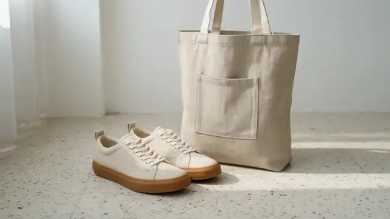</p>

[▶ 观看完整视频（MP4）](assets/w11.mp4)

*帆布鞋和一只亚麻包在浅色地板上，镜头正在靠近。参考图也是由 Beatra AI 生成。*

在你的 Agent 里这样说：

```text
用 Wan 3.0 Video，拿燕麦色帆布鞋照片和燕麦色亚麻包照片，做一段两者在白墙前浅色水磨石上的缓慢推进。
```

提示词：

```text
A short catalog clip of the oatmeal sneaker and the oat linen tote together on a pale terrazzo floor against a white wall. Morning light, slow push-in. Keep the gum sole and the tote's patch pocket. No text, no logos, no hands.
```

Wan 3.0 Video · 参考生视频 · 720p · 16:9 · 3s

在 Beatra 上生成 · 任务 task_mcp_624760781be03b029dcdc2fcf9bc52cdd0f9959e

### 12. 雨衣狐狸在面包店外

雨衣狐狸站在面包店前，展示 Wan 3.0 Video 跟着两张插画参考走。

<p align="center">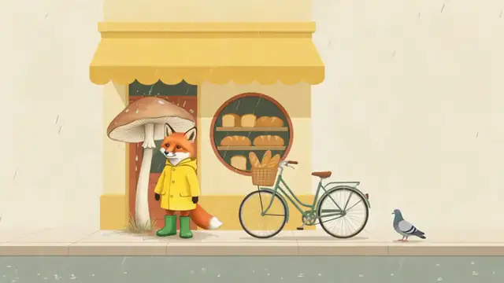</p>

[▶ 观看完整视频（MP4）](assets/w12.mp4)

*穿黄色外套的狐狸站在面包店前的人行道上。参考图也是由 Beatra AI 生成。*

在你的 Agent 里这样说：

```text
用 Wan 3.0 Video，拿雨衣狐狸的画和面包店的画，让狐狸站在黄色遮阳篷下的人行道上，篷布轻轻动一下。
```

提示词：

```text
A short illustrated clip. The red fox in the yellow raincoat and green boots stands on the sidewalk in front of the bakery with the butter-yellow awning and the bicycle. A small breeze moves the awning. No text, no logos.
```

Wan 3.0 Video · 参考生视频 · 720p · 16:9 · 3s

在 Beatra 上生成 · 任务 task_mcp_ca240b90f5508336024a11c8fd8226cdd4581f22

<a id="native-audio"></a>

## 环境音

### 13. 小屋前的雪和烟

雪和烟囱的烟，是一段 Wan 3.0 Video 的小屋镜头。成片带声音。

<p align="center"></p>

[▶ 观看完整视频（MP4）](assets/w13.mp4)

*雪落在小屋上，烟囱冒着烟，镜头正在靠近。开头的照片也是由 Beatra AI 生成。*

在你的 Agent 里这样说：

```text
用 Wan 3.0 Video 把这张下雪的小屋静帧动起来：雪花落下，烟囱的烟向左卷，镜头慢慢推进，声音是风和落雪。
```

提示词：

```text
Gentle falling snow drifts down across the whole scene in soft, slow flakes. Chimney smoke rises and curls lazily to the left. The window light glows warmly with a faint flicker. The camera makes one slow, smooth push-in toward the cabin. The cabin, roof, pine trees and mountains stay still and keep their exact shape. Calm, quiet winter evening pacing. Soft ambient sound of wind and falling snow.
```

Wan 3.0 Video · 图生视频 · 720p · 16:9 · 5s

在 Beatra 上生成 · 任务 task_mcp_38a287641ce61bf1d0ab5fe2892aab3f86ba3643, task_mcp_4164f98cbccff4bdb8588c227998756a9f3d8423

### 14. 面包店台阶上的雨

面包店台阶上的雨，是一段 Wan 3.0 Video 的片子。成片带声音。

<p align="center"></p>

[▶ 观看完整视频（MP4）](assets/w14.mp4)

*雨打在黄色遮阳篷下的湿台阶上，声轨里是雨声和一声店铃。由 Beatra AI 生成。*

在你的 Agent 里这样说：

```text
用 Wan 3.0 Video 做一段虚构面包店外的雨夜：黄油黄色遮阳篷下，雨打在湿石阶上，声轨是雨声和一声轻的店铃。不要人声，也不要标志。
```

提示词：

```text
Rainy evening outside a small fictional bakery. Rain strikes a wet stone step under a dripping butter-yellow awning, with a dark green door behind. The soundtrack is rain and one soft distant shop bell. No speech, no music, no people, no readable text, no logos.
```

Wan 3.0 Video · 文生视频 · 720p · 16:9 · 4s

在 Beatra 上生成 · 任务 task_mcp_d62a422f1980a916a57b1f20bb5e679e138795f6

## 为什么在 Beatra 上跑

- 本清单用到的模型：Wan 3.0 Video。
- 安装免费。每次生成消耗 Beatra 账号积分，只有你明确要求这次生成或批准确认卡后才会付费。
- 支持的 Agent：Claude Code、Cursor、Codex、Windsurf、Cline、OpenClaw。

## 贡献

欢迎用 issue 提出想看的案例。本清单不收第三方作品。

## 许可

本清单的提示词与素材使用 CC BY 4.0。转载需要署名并带回链。

## 相关链接

- [Awesome Qwen Image 3.0](https://github.com/beatra-ai/awesome-qwen-image-3)
- [AI Video Generator Skill](https://github.com/beatra-ai/ai-video-generator-skill)
- [Beatra Skills](https://github.com/beatra-ai/beatra-skills)
- [beatra.ai](https://beatra.ai/?utm_source=github&utm_medium=cases_list&utm_campaign=awesome-wan-3-video)
